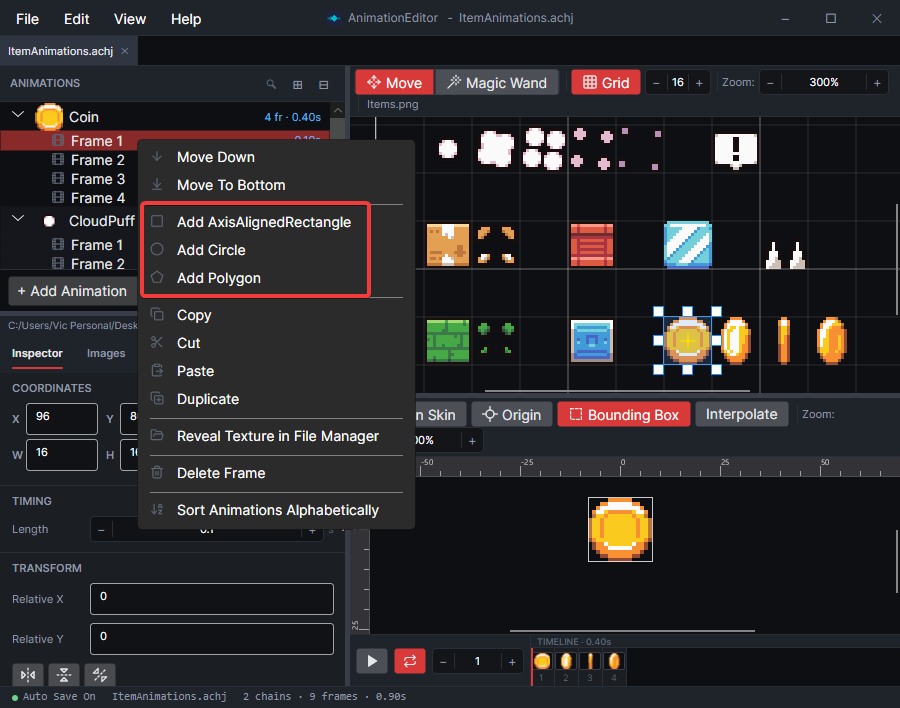
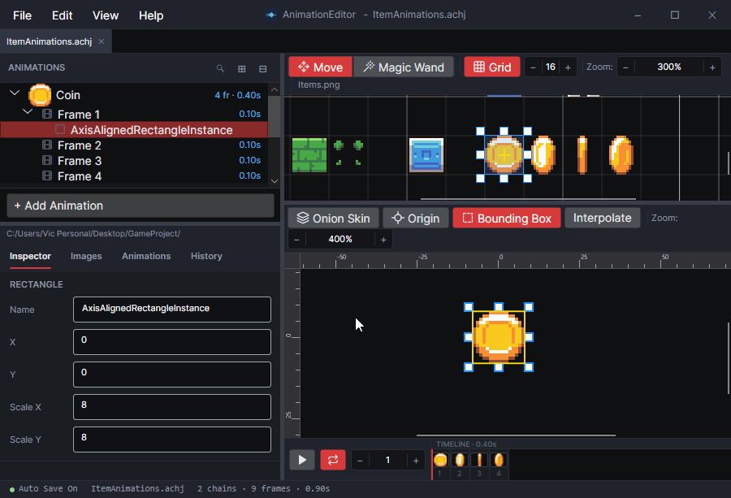
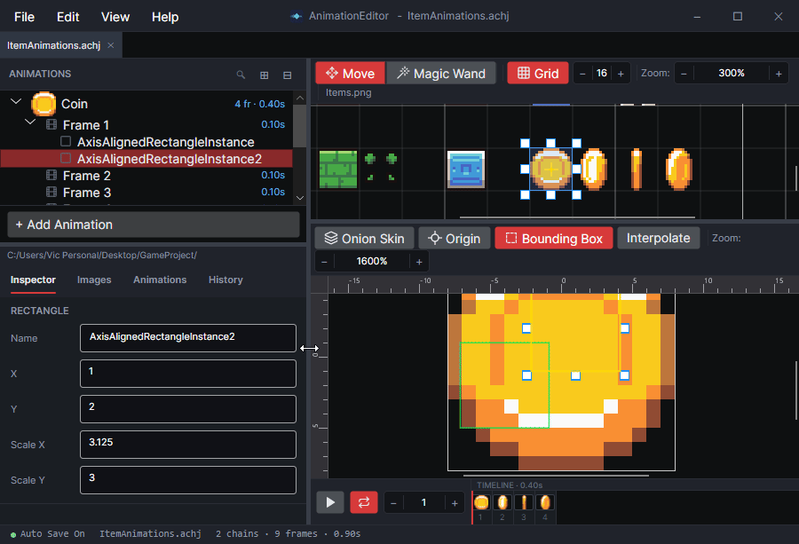
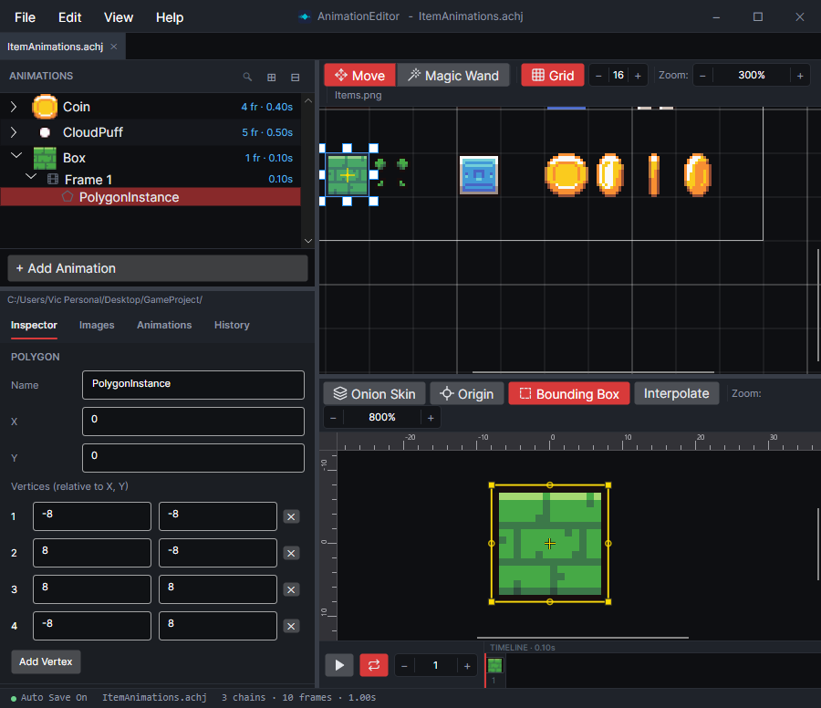
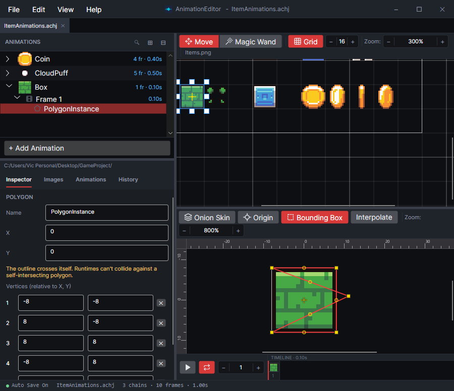

# Add Shapes to Frames

### Frame Shapes

Frames support holding multiple shapes. The three types of shapes supported are:

* Rectangle
* Circle
* Polygon

These shapes can be used to define an object's collision or mark spots relevant to your game such as bullet origin.

### Adding Shapes

To add a shape, right-click on an existing frame and select the option to add one of the types of shapes:

<figure><figcaption></figcaption></figure>

Shapes appear in the bottom preview tab when viewing a frame or animation.

<figure><figcaption>
Rectangle in a frame
</figcaption></figure>

### Editing Shapes

Shapes can be edited by changing the position and size variables in the Inspector tab, or by editing the shape in the preview tab.

<figure><figcaption>
Editing a Shape in the preview window
</figcaption></figure>

If multiple shapes are added to a frame, they can be selected in the animation list or in the preview tab. Note that clicking on overlapping shapes cycles between them.

<figure><figcaption>
Selecting overlapping shapes
</figcaption></figure>

### Polygons

Polygons provide additional flexibility in the form of supporting multiple arbitrary points.

<figure><figcaption>
Polygon on a shape
</figcaption></figure>

Polygon points can be edited in the Inspector or by clicking and dragging in the preview tab.

To delete a point, click on its X button in the Inspector, or highlight the point and click the delete key on the keyboard.

Polygons can be convex or concave, but the polygon should not cross over itself. If so, it is marked red to indicate an error.

<figure><figcaption>
Invalid polygon crossing over itself
</figcaption></figure>

### Glide Shapes Between Frames

A shape's position and size can glide from one frame to the next instead of changing instantly. Select a rectangle, circle or polygon and use the keyframe diamond and curve buttons above its **Offset** fields (X and Y) and, for rectangles and circles, above its **Size** fields (Scale X and Scale Y, or Radius). A polygon has no size; its **Points** have their own diamond and curve buttons above the vertex list. They work like the ones in [Glide Between Frames](edit-frames.md#glide-between-frames), and Offset, Size and Points are independent.

Shapes are matched from frame to frame by name. A glide runs to the next frame that has a shape with the same name and a keyframe turned on, and stops where the name is missing, repeated in a frame, or changes shape type. A shape with no name never glides. The first frame that has a given name is always a keyframe.

While one shape is selected, the timeline shows that shape's **Offset** and **Size** lanes (**Offset** and **Points** for a polygon) under the frame cells in place of the frame's own lanes: a diamond at each keyframe and the curve to the next one. They cover every frame that has a shape with the same name, whichever frame's shape you selected, and leave a gap where the name is missing. Selecting several shapes shows no lanes.

Polygon points glide vertex by vertex: the first vertex goes to the first vertex of the next frame, the second to the second, and so on, so a polygon that is re-wound with a different starting vertex glides slot to slot. If the vertex count differs between the two frames, the polygon snaps instead of gliding. While the Points keyframe is off, the vertex list shows the glided values read-only. Shape colors do not glide.
